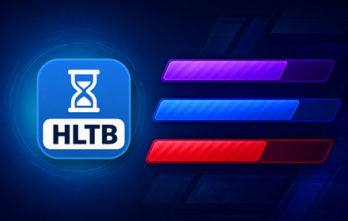
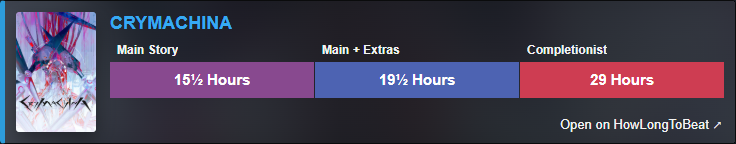

# HLTB for Steam

**English** | [Русский](README.ru.md)

An independent, privacy-conscious Chrome and Firefox extension that displays HowLongToBeat completion times directly on Steam game pages, including pages opened in the Steam desktop client.

<p align="center">
  
</p>

## Features

- Main Story, Main + Extras, and Completionist estimates.
- Compact Steam-style card using artwork already loaded by the Steam page.
- Automatic interface localization for 14 widely used browser languages, with English fallback.
- Configurable categories, time format, and cache lifetime.
- Strict title matching: the extension never substitutes an uncertain game's times.
- No analytics, ads, accounts, remote executable code, or developer-operated backend.

Supported interfaces and store listings: English, Russian, German, French, Spanish, Brazilian Portuguese, Italian, Polish, Ukrainian, Turkish, Japanese, Korean, Simplified Chinese, and Traditional Chinese.

## Interface

<p align="center">
  
</p>

## Data sources

| Environment | Preferred source | Fallback |
| --- | --- | --- |
| Chrome / Chromium | Current HowLongToBeat response | Local cache, signed current snapshot, then packaged snapshot |
| Firefox | Current HowLongToBeat response | Local cache, signed current snapshot, then packaged snapshot |
| Steam desktop client | Signed current snapshot | Packaged snapshot |

HLTB rejects requests from Steam's embedded Chromium, so Steam mode never contacts its API. Version 2.2 checks a signed static data channel at most once every 24 hours and downloads a roughly 1.6 MB data-only snapshot when its calendar version changes. These fixed update requests contain no Steam App ID or game title. The packaged October 12, 2026 snapshot remains available when the channel is unavailable and takes priority over older stored snapshots after an extension upgrade. An installed snapshot update refreshes the open game card automatically. In regular browsers, only the current Steam game title is sent to HowLongToBeat over HTTPS. See the [Privacy Policy](https://devln737.github.io/hltb-for-steam-unofficial/privacy.html) and its [repository source](PRIVACY.md).

## Install a development build

The downloadable packages are sideload builds until the extension is published and signed by the stores.

### Chrome and Chromium

1. Extract `hltb-for-steam-unofficial-<version>-chrome.zip`.
2. Open `chrome://extensions` and enable **Developer mode**.
3. Select **Load unpacked** and choose the extracted directory.

### Firefox

1. Open `about:debugging#/runtime/this-firefox`.
2. Select **Load Temporary Add-on**.
3. Select `manifest.json` from the extracted Firefox ZIP, or the explicitly named unsigned development XPI.

Permanent installation in standard Firefox requires Mozilla signing through AMO. See the [Firefox publishing checklist](docs/FIREFOX_AMO.md).

## Development

Supported build environments: Windows, macOS, and Linux.

Install [Node.js 22 or newer](https://nodejs.org/en/download). The official
Node.js installer includes npm, so no separate npm installation is required.
Verify the environment with:

```sh
node --version
npm --version
```

The Node.js version must be 22 or newer. Dependency versions are locked in
`package-lock.json` and installed reproducibly with `npm ci`. No private
packages, credentials, environment variables, external build services, or
network scraping are required.

Start a development build:

```sh
npm ci
npm run dev
```

Run the automated checks and build both browser packages:

```sh
npm run check
npx playwright install chromium
npm run test:browser
npm run build:firefox
npm run verify:firefox
npm run zip:all
```

Release packaging (`zip:all`) requires a signed-channel packaged snapshot whose source date is no more than 72 hours old. Run `npm run snapshot:update-packaged` after the updater has completed and published a fresh cycle, then rerun the checks. CI and reproducible packaging of older sources use `zip:build` without this release-only freshness gate.

To reproduce only the Firefox package submitted to Mozilla, extract the source
archive, open a terminal in its root directory, and run:

```sh
npm ci
npm run build:firefox
npm run verify:firefox
npm run xpi:firefox:unsigned
```

The unpacked Firefox extension is produced in `.output/firefox-mv3/`. The AMO
submission archive is written to
`.output/hltb-for-steam-unofficial-<version>-firefox.zip`. WXT bundles the
generated JavaScript from the included TypeScript sources. The local HLTB
snapshot is a static build input; the build does not contact HowLongToBeat.

Package outputs are written to the ignored `.output/` directory:

- `*-chrome.zip` — Chrome/Chromium and Chrome Web Store package;
- `*-firefox.zip` — AMO submission package;
- `*-firefox-unsigned.xpi` — temporary development package;
- `*-sources.zip` — matching reviewer source archive.

## Architecture

The content script reads the Steam App ID, visible title, and an existing Steam artwork URL, then renders the card inside Shadow DOM. A Manifest V3 service worker handles the HLTB adapter, strict matching, request concurrency, versioned local cache, and snapshot lookup.

The packaged schema-v7 snapshot contains 84,881 useful HLTB games: every one of the 59,688 games with completion-time data, plus Steam-linked games without submitted times, with 59,404 unambiguous Steam App ID mappings. Empty games without times, Steam mappings, or overrides remain in the private updater database but are omitted from distributed snapshots. Version 2.2 can atomically install a signed schema-v7 snapshot in IndexedDB while retaining the previous remote version and the packaged fallback. Each record carries its compact last-successful-check date for internal freshness comparisons; the widget omits the check date and retains completion-time change indicators. Remote packs contain 16 gzip front-coded binary title buckets with compact completion-time deltas and 16 gzip ULEB128 App ID indexes; they cannot contain executable code or configuration. Images, descriptions, reviews, and the 755,986,614-byte source scrape are never packaged. The complete packaged snapshot payload is 1,682,645 bytes.

Records are refreshed incrementally; individual check dates can be older than the snapshot's source date. The source date does not mean that every game was rechecked on that day.

The packaged fallback is updated manually from the verified signed channel:

```sh
npm run snapshot:update-packaged
npm run verify:snapshot
```

Public extension CI validates committed data and never scrapes HLTB. Incremental collection and signed data-channel generation run in a separate private Forgejo updater repository; its SQLite state, scraper, signing key, and raw input are not part of this project or its reviewer source archive. The Development section
above contains the complete reproducible-build instructions used by Mozilla
reviewers.

## Publishing

- [Chrome Web Store checklist](docs/CHROME_WEB_STORE.md)
- [Firefox AMO checklist](docs/FIREFOX_AMO.md)
- [Store assets](docs/STORE_ASSETS.md)
- [Known issues](docs/KNOWN_ISSUES.md)

## Privacy and independence

This project is not affiliated with, endorsed by, or sponsored by Valve Corporation, Steam, or HowLongToBeat. Product names and trademarks belong to their respective owners.

Inspired by the original [k4sr4/hltbsteam](https://github.com/k4sr4/hltbsteam) project and rebuilt as a clean TypeScript/WXT Manifest V3 extension.

## License

[MIT](LICENSE)
