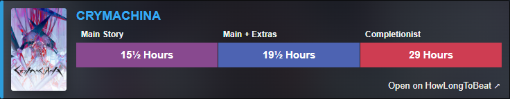

# HLTB for Steam

[English](README.md) | **Русский**

Независимое и ориентированное на приватность расширение для Chrome и Firefox. Оно показывает время прохождения HowLongToBeat непосредственно на страницах игр Steam, в том числе открытых внутри настольного клиента Steam.

<p align="center">
  
</p>

## Возможности

- Оценки Main Story, Main + Extras и Completionist.
- Компактная карточка в стиле Steam с уже загруженной страницей обложкой.
- Автоматическая локализация интерфейса для 14 распространённых языков браузера с английским fallback.
- Настройка отображаемых категорий, формата времени и срока хранения кэша.
- Строгое сопоставление названий: расширение не подставляет время от сомнительно совпавшей игры.
- Без аналитики, рекламы, аккаунтов, удалённо исполняемого кода и собственного сервера разработчика.

Поддерживаемые языки интерфейса и карточки магазина: английский, русский, немецкий, французский, испанский, бразильский португальский, итальянский, польский, украинский, турецкий, японский, корейский, упрощённый и традиционный китайский.

## Интерфейс

<p align="center">
  
</p>

## Источники данных

| Среда | Основной источник | Резервный источник |
| --- | --- | --- |
| Chrome / Chromium | Актуальный ответ HowLongToBeat | Локальный кэш, подписанный актуальный снимок, затем встроенный снимок |
| Firefox | Актуальный ответ HowLongToBeat | Локальный кэш, подписанный актуальный снимок, затем встроенный снимок |
| Настольный клиент Steam | Подписанный актуальный снимок | Встроенный снимок |

HLTB отклоняет запросы встроенного Chromium клиента Steam, поэтому в режиме Steam расширение вообще не обращается к его API. Версия 2.2 не чаще раза в 24 часа проверяет подписанный статический канал данных и при смене календарной версии загружает data-only snapshot размером около 1,6 МБ. Эти одинаковые для всех запросы не содержат Steam App ID или название игры. Автоматически обновляемый встроенный снимок остаётся автономным резервным источником и после обновления расширения получает приоритет над более старыми сохранёнными снимками. После установки нового снимка открытая карточка игры обновляется автоматически. В обычном браузере на HowLongToBeat по HTTPS отправляется только название открытой игры Steam. Подробнее: [политика конфиденциальности](https://devln737.github.io/hltb-for-steam-unofficial/privacy.html) и её [исходный текст](PRIVACY.md).

## Установка сборки для разработки

До публикации и подписания магазинами доступные пакеты предназначены для ручной установки.

### Chrome и Chromium

1. Распакуйте `hltb-for-steam-unofficial-<version>-chrome.zip`.
2. Откройте `chrome://extensions` и включите **Режим разработчика**.
3. Нажмите **Загрузить распакованное расширение** и выберите полученную папку.

### Firefox

1. Откройте `about:debugging#/runtime/this-firefox`.
2. Выберите **Загрузить временное дополнение**.
3. Укажите `manifest.json` из распакованного Firefox ZIP или явно помеченный неподписанный XPI для разработки.

Для постоянной установки в обычном Firefox требуется подпись Mozilla через AMO. См. [чек-лист публикации Firefox](docs/FIREFOX_AMO.md).

## Разработка

Требуются Node.js 22 или новее и npm.

```sh
npm ci
npm run dev
```

Запуск проверок и сборка пакетов для обоих браузеров:

```sh
npm run check
npx playwright install chromium
npm run test:browser
npm run build:firefox
npm run verify:firefox
npm run zip:all
```

Сборка релизных архивов (`zip:all`) требует встроенный снимок из подписанного канала с датой источника не старше 72 часов. После завершения и публикации свежего цикла updater выполните `npm run snapshot:update-packaged` и повторите проверки. CI и воспроизводимая упаковка старых исходников используют `zip:build` без этой проверки свежести релиза.

Пакеты создаются в игнорируемой папке `.output/`:

- `*-chrome.zip` — пакет для Chrome/Chromium и Chrome Web Store;
- `*-firefox.zip` — пакет для отправки в AMO;
- `*-firefox-unsigned.xpi` — временный пакет для разработки;
- `*-sources.zip` — соответствующий архив исходного кода для ревью.

## Архитектура

Content script получает Steam App ID, видимое название и URL уже загруженного страницей изображения, после чего создаёт карточку внутри Shadow DOM. Service worker Manifest V3 отвечает за адаптер HLTB, строгое сопоставление, ограничение параллельных запросов, версионированный локальный кэш и поиск в снимках.

Встроенный снимок schema v7 содержит время прохождения, сопоставления со Steam, реальные даты успешной проверки записей и компактную историю изменений времени. Точное покрытие и размеры указаны в [`snapshot.json`](public/data/hltb-snapshot/snapshot.json). Версия 2.2 атомарно устанавливает подписанный снимок в IndexedDB, сохраняя предыдущую удалённую версию и встроенный fallback. Архив содержит 16 gzip-сжатых бинарных бакетов названий и 16 ULEB128-индексов App ID; исполняемый код, изображения, описания, отзывы и исходные страницы в него не входят.

Записи проверяются поэтапно; дата проверки отдельной игры может быть старше даты источника снимка. Дата снимка не означает, что все игры были перепроверены в этот день.

Встроенный fallback и подписанный канал обновляются вместе по расписанию workflow **Update HLTB data**. Также доступен ручной импорт из проверенного канала:

```sh
npm run snapshot:update-packaged
npm run verify:snapshot
```

Код расширения, Python-сборщик (`updater/`) и версии подписанных данных (`docs/data/`) находятся в одном репозитории с сохранением импортированной Git-истории. GitHub Actions каждый час проверяет срок следующего сбора. Пока остаются просроченные записи, успешный сбор сам запускает следующую порцию; после опустошения очереди возвращается интервал шесть часов. Один запуск выполняет до 90 минут последовательных запросов за запуск. SQLite сохраняется в prerelease `updater-state`, поэтому следующие задания продолжают длинные проходы. Ключ подписи хранится только в Actions secret. Состояние содержит игровые данные и статусы сбора, без ключей и исходных страниц. Обычный CI проверяет готовые данные и не обращается к HLTB.

Версия 2.2.6 использует новый ключ подписи и канал `/data/v2/` на GitHub Pages этого репозитория. Прежний репозиторий данных сохранён для старых версий расширения. Эксплуатация и восстановление описаны в [`updater/README.md`](updater/README.md).

## Публикация

- [Чек-лист Chrome Web Store](docs/CHROME_WEB_STORE.md)
- [Чек-лист Firefox AMO](docs/FIREFOX_AMO.md)
- [Ассеты магазинов](docs/STORE_ASSETS.md)
- [Известные проблемы](docs/KNOWN_ISSUES.md)

## Приватность и независимость

Проект не связан с Valve Corporation, Steam или HowLongToBeat, не одобрен и не спонсируется ими. Названия продуктов и товарные знаки принадлежат их владельцам.

Проект вдохновлён исходным расширением [k4sr4/hltbsteam](https://github.com/k4sr4/hltbsteam) и полностью переписан как чистое расширение Manifest V3 на TypeScript/WXT.

## Лицензия

[MIT](LICENSE)
